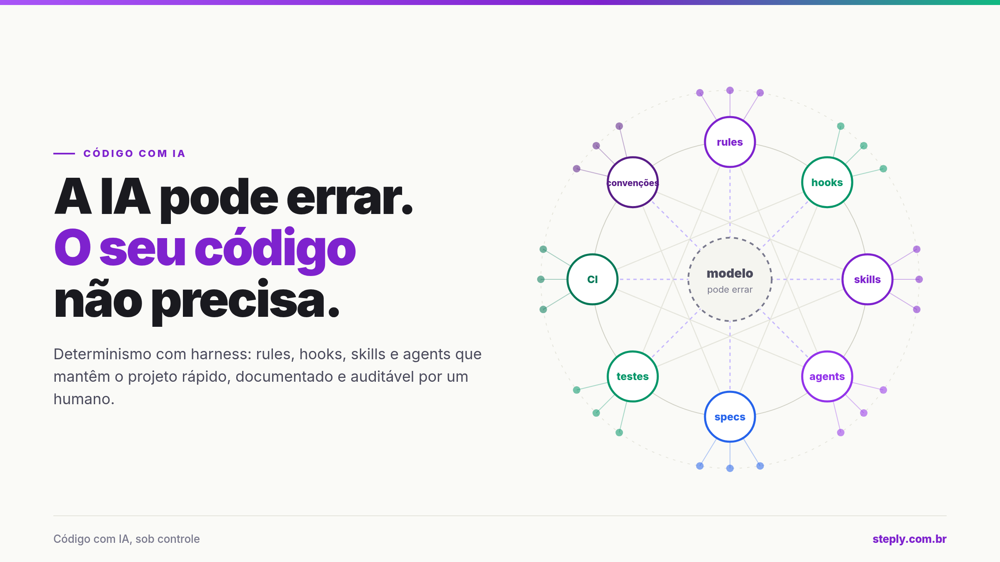
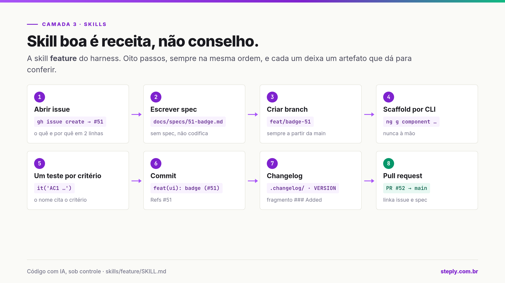
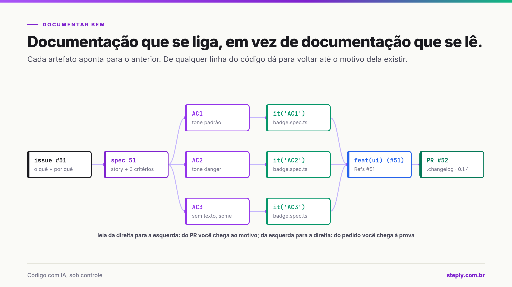
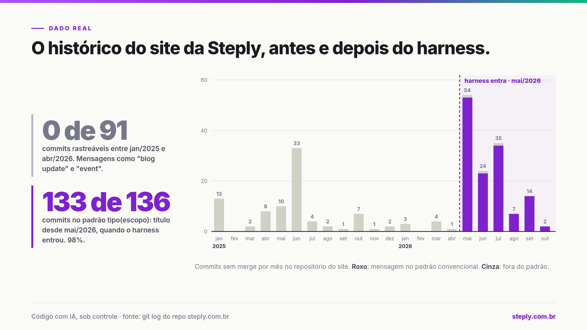

# artigo-pranchas

Skill de [Claude Code](https://claude.com/claude-code) que escreve post técnico em duas mídias:
o **texto** pronto para colar no LinkedIn, Medium ou blog, e o **carrossel de pranchas**
1200×675 em HTML/SVG, exportado para PNG.

| | |
|---|---|
|  |  |
|  |  |

## Instalar

```
/plugin marketplace add LucasHiago/artigo-pranchas
/plugin install create@artigo-pranchas
```

Na instalação o Claude Code pergunta a **URL da sua empresa** (vai no rodapé de toda prancha)
e, opcional, o nome da série. Para trocar depois:

```
/plugin configure create@artigo-pranchas
```

## Usar

```
/create:article como a gente versiona o banco neste repo
```

Ou peça em linguagem natural ("escreve um post com pranchas sobre ..."), que a skill dispara sozinha.

A skill segue sempre os mesmos passos:

1. **roteiro**: uma tabela com a afirmação de cada prancha, o layout e o dado concreto;
2. **pranchas** em `artigo-<slug>/sessoes.html`, a partir de um catálogo de 16 layouts
   (pipeline, grafo, timeline, matriz 2×2, queijo suíço, código ruim × bom, gráfico com dado real...);
3. **export** com `export.sh`, que gera `img/card-NN.png` em 2× e **falha se algum texto estourar**
   a prancha (o card tem altura fixa, e texto cortado sumiria calado do PNG);
4. **texto** em `artigo.html`: uma seção por prancha, na mesma ordem, com o mapa das imagens.

## O que vem

```
plugins/create/skills/article/
  SKILL.md                 os passos
  templates/sessoes.html   design system + 16 pranchas de exemplo (é o catálogo)
  templates/artigo.html    esqueleto do texto
  templates/export.sh      exportador com trava de estouro
  references/layouts.md    qual layout para qual ideia; como trocar a marca
  references/texto.md      estrutura e estilo do texto
```

As pranchas de exemplo são o post "A IA pode errar. O seu código não precisa", sobre harness
de IA para código. A URL configurada substitui o rodapé; cores em `references/layouts.md` → *Trocar a marca*.

## Requisitos

- Google Chrome ou Chromium no `PATH` (ou `CHROME=/caminho/do/binario`) para o export.
- Fontes Inter e JetBrains Mono vêm do Google Fonts; o export precisa de rede.

## Licença

MIT
